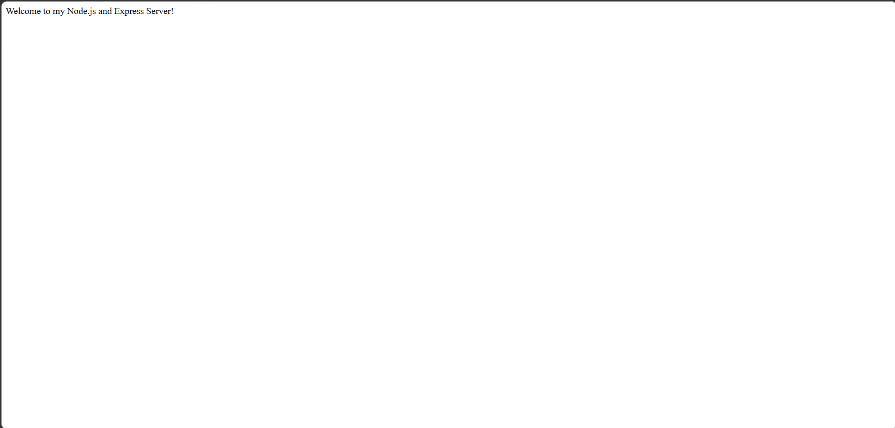
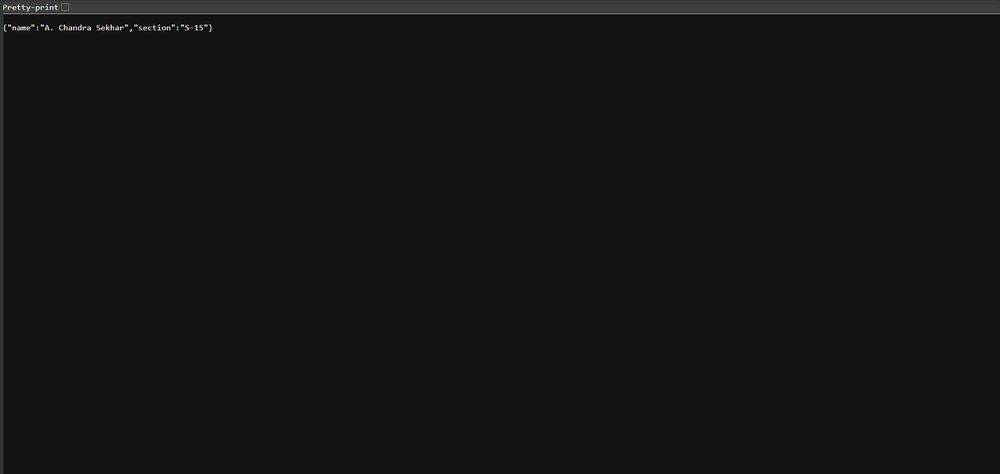

# Lab 1: Node.js and Express Server

**Name:** A. Chandra Sekhar

**Registration Number:** 252U1R1007

**Section:** S-15

## Live Deployment Link

https://bdf1-chandrasekhar.onrender.com

## Project Description

This project demonstrates the creation of a basic HTTP server using Node.js and an Express server with different API endpoints.

## Installation and Execution

1. Clone the repository.
2. Open the project folder in VS Code.
3. Install dependencies:

```bash
npm install
```

4. Start the server:

```bash
node server.js
```

5. Open http://localhost:3000 in your browser.

## API Endpoints

| Method | Endpoint | Description |
|---|---|---|
| GET | `/` | Displays a welcome message |
| GET | `/about` | Returns name and section in JSON format |
| GET | `/time` | Displays the current date and time |
| GET | Any unknown route | Returns 404 Not Found |

## Screenshots

### 1. Home Endpoint



### 2. About Endpoint



### 3. Time Endpoint


### 4. 404 Not Found


## Notes

- Successfully created a Node.js HTTP server.
- Installed Express.js.
- Implemented the required API endpoints.
- Tested the endpoints using a web browser.
- Verified HTTP status codes.

## Technologies Used

- Node.js
- Express.js
- JavaScript